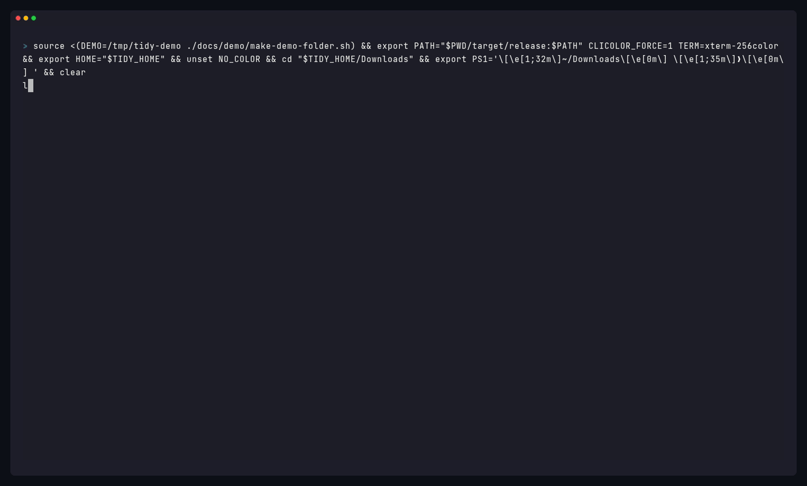
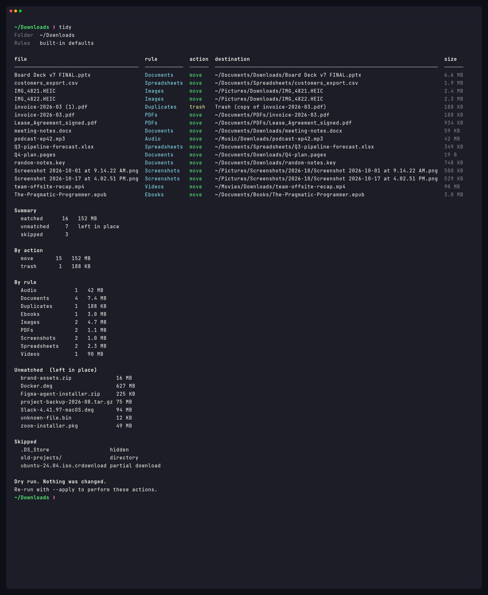
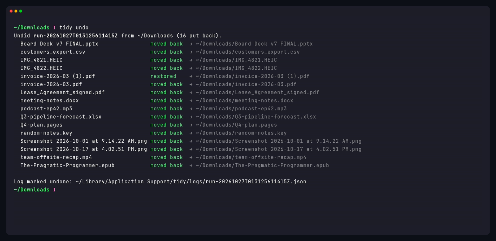
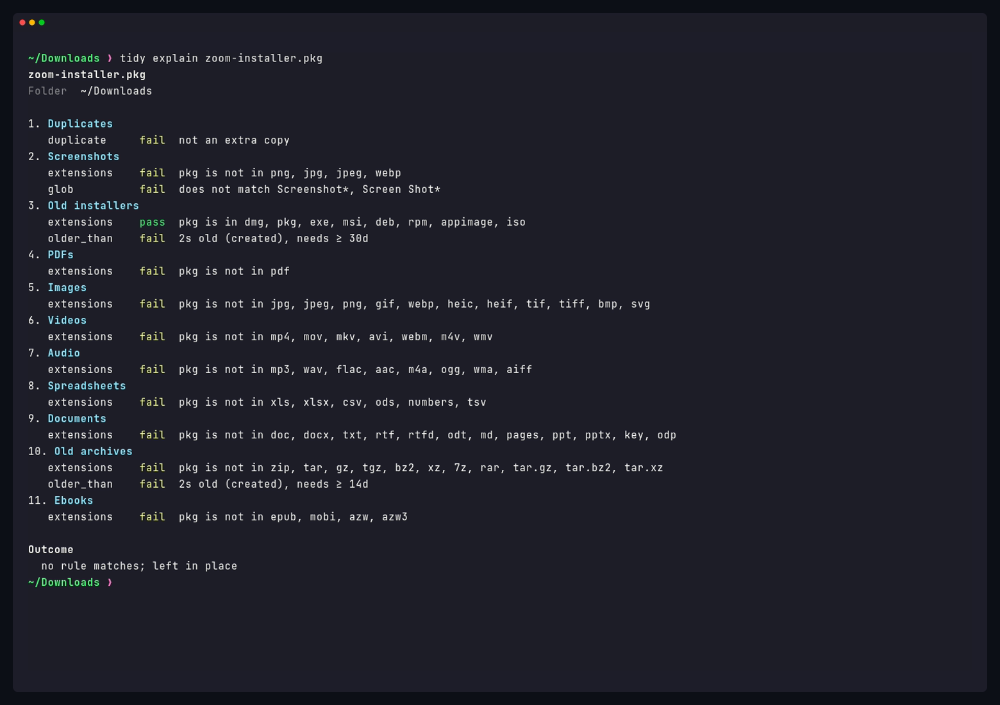

<h1 align="center">tidy</h1>

<p align="center">
  <b>Clean up a messy Downloads folder in one command, without risking your files.</b><br>
  A safe, rules-driven file organizer for macOS (Linux and Windows too), written in Rust.<br>
  Dry-run by default · Trash, never delete · Never overwrites · One-command undo
</p>

<p align="center">
  <a href="https://github.com/Jherin89/tidy/actions/workflows/ci.yml"></a>
  <a href="https://github.com/Jherin89/tidy/releases/latest"></a>
  <a href="LICENSE"></a>
  
  
</p>

<p align="center">
  
</p>

```bash
tidy            # preview what would happen to ~/Downloads (changes nothing)
tidy --apply    # do it
tidy undo       # changed your mind? put everything back
```

---

## Contents

- [Why tidy?](#why-tidy)
- [Features](#features)
- [Safety](#safety)
- [Setup guide (step by step)](#setup-guide-step-by-step)
- [Usage guide (step by step)](#usage-guide-step-by-step)
- [Writing rules](#writing-rules)
- [Built-in rules](#built-in-rules)
- [Where tidy keeps its files](#where-tidy-keeps-its-files)
- [Command reference](#command-reference)
- [macOS smoke test](#macos-smoke-test)
- [FAQ and troubleshooting](#faq-and-troubleshooting)
- [Contributing](#contributing)
- [License](#license)

## Why tidy?

Downloads folders fill up with invoices, screenshots, HEIC photos from your phone, installers you ran once, and zip files you already unpacked. Cleaning by hand is tedious, and most "auto-organizer" apps move things without telling you first or delete files you wanted to keep.

tidy works the other way around:

1. **You see the plan first.** A plain `tidy` prints a table of every file, the rule it matched, and where it would go. Nothing moves until you say `--apply`.
2. **Your rules, in plain text.** "PDFs go to `~/Documents/PDFs`", "installers older than 30 days go to the Trash". Rules live in one small TOML file you can read and edit.
3. **Mistakes are cheap.** Every run is logged, and `tidy undo` reverses it.

## Features

- **Preview table by default.** Shows file, matched rule, action, destination, and size, plus totals per rule and per action.
- **Rules that match on extension, name pattern, age, size, and duplicate copies**, combined however you like. The first matching rule wins.
- **Age from Date Added on a Mac.** `older_than` uses Finder's Date Added when it is available, otherwise the later of created (birth) and modified. A `.dmg` you just copied into Downloads is not old, even if its modified time is months ago. `tidy explain` shows which stamp it used.
- **Package documents as one item.** iWork files (`.pages`, `.numbers`, `.key`), `.rtfd`, and any other directory whose extension is listed on a matching rule are moved or trashed as a whole. Other folders are still skipped.
- **Two actions:** move to any folder (created when needed, with `~` expansion and optional `YYYY-MM` subfolders), or send to the system **Trash**.
- **Sensible built-in rules**, so it works with no setup. The first rule sends extra byte-identical copies to the Trash. Run `tidy init` to get an editable copy.
- **`tidy explain FILE`** shows why that file would be skipped, matched, or left in place.
- **Undo log** for every applied run, and `tidy undo` to reverse the latest one.
- **Watch mode:** `tidy watch` sorts new downloads as soon as they finish. On a Mac, `tidy watch --install` registers a login agent and stores `--rules` / `--older-than` in the plist.
- **Skips files that aren't finished or aren't yours to move:** partial downloads (`.crdownload`, `.part`, `.download`, `.tmp`, `.partial`), hidden files like `.DS_Store`, ordinary folders, and symlinks.
- **`--json` output** for scripts and automations.
- **A single small binary.** No runtime and no background service unless you set one up.

<p align="center">
  
  <br><sub>A real dry run of the built-in rules on a sample Downloads folder.</sub>
</p>

## Safety

tidy is built so that the worst outcome of a bad rule is a few files in the wrong folder, and `tidy undo` fixes that.

| Guarantee | What it means |
| --- | --- |
| **Dry run is the default** | Without `--apply`, nothing is moved or trashed, and no folders are created. The preview ends with `Dry run. Nothing was changed.` |
| **Trash, not delete** | The only removal action is `trash`, which uses the operating system's Trash through the [`trash`](https://crates.io/crates/trash) crate. tidy has no permanent-delete action, and a rule that asks for `delete` is rejected. |
| **Never overwrites** | If `invoice.pdf` already exists at the destination, the new one becomes `invoice (1).pdf`, then `invoice (2).pdf`, and so on. Existing files are never replaced. |
| **Undo** | Every `--apply` (and every watch batch) writes a JSON log. `tidy undo` moves files back to where they were and removes the now-empty folders the run created. Folders that held something before the run, or that you've put something in since, are left alone. |
| **Careful cross-disk moves** | When source and destination are on different disks, tidy copies, checks the size, and only then removes the original. |
| **Leaves partial files alone** | In-progress downloads, hidden files, ordinary folders, and symlinks are never touched. A directory whose extension is listed on a matching rule (a `.pages` package, for example) is one item and is never recursed into. |
| **One config file tidy deletes** | `tidy watch --uninstall` removes the LaunchAgent plist tidy wrote (`~/Library/LaunchAgents/com.github.jherin89.tidy.plist`). That is tidy's own agent file, not a download. |

> [!IMPORTANT]
> **macOS Trash caveat.** On macOS, apps can put files *into* the Trash but there is no supported way to take them back *out* programmatically. So on a Mac, `tidy undo` moves every *moved* file back automatically, but for *trashed* files it prints each file name and its original location so you can drag them back from the Trash (or select them in Finder and choose **File → Put Back**). On Linux and Windows, trashed files are restored automatically.

## Setup guide (step by step)

You don't need to know Rust to use tidy. Pick **Homebrew**, a **release archive**, or **build it yourself**.

### Option A: Homebrew (recommended)

Works on macOS (Apple Silicon and Intel) and Linux. Homebrew also handles updates, and it doesn't need the quarantine step that a browser download does.

1. **Open Terminal** (press <kbd>⌘</kbd> <kbd>Space</kbd>, type *Terminal*, press <kbd>Return</kbd>).
2. **Make sure Homebrew is installed.** Run `brew --version`. If you get `command not found`, install it with the one-line command from [brew.sh](https://brew.sh), then follow the "Next steps" it prints (they add `brew` to your PATH) and open a new Terminal window.
3. **Install tidy:**
   ```bash
   brew install jherin89/tap/tidy
   ```
   This adds the [jherin89/tap](https://github.com/Jherin89/homebrew-tap) tap and installs the prebuilt binary: universal on macOS, static musl on Linux. Each download is checked against a pinned SHA-256.
4. **Verify it works:**
   ```bash
   tidy --version     # → tidy 0.3.0
   tidy               # safe: only shows a preview of ~/Downloads
   ```
5. **Later:** `brew upgrade tidy` updates it, and `brew uninstall tidy` removes it. If you set up the background watcher, run `tidy watch --uninstall` first.

### Option B: download a release archive

1. **Download** the archive for your machine from the [latest release](https://github.com/Jherin89/tidy/releases/latest):
   - Mac (Apple Silicon or Intel): `tidy-0.3.0-universal-apple-darwin.tar.gz`
   - Linux x86_64: `tidy-0.3.0-x86_64-unknown-linux-musl.tar.gz`
   - Linux aarch64: `tidy-0.3.0-aarch64-unknown-linux-musl.tar.gz`
2. **Open Terminal.**
3. **Optional: check the download.** Compare this output with the `.sha256` file on the release page (`shasum -a 256` writes `hash  filename`):
   ```bash
   cd ~/Downloads
   shasum -a 256 tidy-0.3.0-universal-apple-darwin.tar.gz
   ```
4. **Unpack it** (use the name you downloaded):
   ```bash
   tar -xzf tidy-0.3.0-universal-apple-darwin.tar.gz
   ```
5. **On a Mac, remove the quarantine flag.** The binary isn't notarized, so without this step macOS says it "cannot be opened because the developer cannot be verified":
   ```bash
   xattr -d com.apple.quarantine tidy-0.3.0-universal-apple-darwin/tidy
   ```
   If it says `No such xattr`, the flag wasn't set and you can move on. Linux builds are static musl binaries and do not need this step.
6. **Put `tidy` on your PATH.** Choose one:
   - **For your user only (no password needed):**
     ```bash
     mkdir -p ~/.local/bin
     mv tidy-0.3.0-universal-apple-darwin/tidy ~/.local/bin/
     echo 'export PATH="$HOME/.local/bin:$PATH"' >> ~/.zshrc
     source ~/.zshrc
     ```
   - **System-wide (asks for your password):**
     ```bash
     sudo mkdir -p /usr/local/bin
     sudo mv tidy-0.3.0-universal-apple-darwin/tidy /usr/local/bin/
     ```
7. **Verify it works:**
   ```bash
   tidy --version     # → tidy 0.3.0
   tidy               # safe: only shows a preview of ~/Downloads
   ```
8. **Clean up the installer files** (optional): `rm -r ~/Downloads/tidy-0.3.0-*`

### Option C: build from source with Rust (any Mac, Linux, or Windows)

1. **Install Rust** with the official installer, [rustup](https://rustup.rs), and accept the defaults:
   ```bash
   curl --proto '=https' --tlsv1.2 -sSf https://sh.rustup.rs | sh
   ```
   Then open a **new** Terminal window, or run `source "$HOME/.cargo/env"`.
2. **macOS only:** if you're asked to install the *Command Line Developer Tools*, click **Install** (or run `xcode-select --install`).
3. **Build and install tidy:**
   ```bash
   cargo install --git https://github.com/Jherin89/tidy
   ```
   This takes a minute or two and puts `tidy` in `~/.cargo/bin`, which rustup already added to your PATH.
4. **Verify:** `tidy --version`

> **Note on the name:** the command is `tidy`, but the Cargo *package* is named **`tidy-dl`**, because `tidy` on crates.io belongs to an unrelated project. Install from this repository as shown above. `cargo install tidy` would install that other project.

**Updating:** `brew upgrade tidy`, download the newer release (Option B), or run `cargo install --git https://github.com/Jherin89/tidy --force` (Option C).
**Uninstalling:** delete the `tidy` binary (`which tidy` shows where it is). You can also remove the config and log folders listed in [Where tidy keeps its files](#where-tidy-keeps-its-files).

## Usage guide (step by step)

### 1. Preview your first clean-up

```bash
tidy
```

With no folder argument, tidy looks at `~/Downloads`. It **only prints a plan**. Nothing changes yet.

### 2. Read the table

An excerpt of the run in the screenshot above:

```text
file                                     rule          action  destination                                                             size
───────────────────────────────────────  ────────────  ──────  ──────────────────────────────────────────────────────────────────────  ──────
IMG_4821.HEIC                            Images        move    ~/Pictures/Downloads/IMG_4821.HEIC                                      2.4 MB
invoice-2026-03 (1).pdf                  Duplicates    trash   Trash (copy of invoice-2026-03.pdf)                                     188 KB
invoice-2026-03.pdf                      PDFs          move    ~/Documents/PDFs/invoice-2026-03.pdf                                    188 KB
Q3-pipeline-forecast.xlsx                Spreadsheets  move    ~/Documents/Spreadsheets/Q3-pipeline-forecast.xlsx                      349 KB
Q4-plan.pages                            Documents     move    ~/Documents/Downloads/Q4-plan.pages                                     19 B
Screenshot 2026-10-01 at 9.14.22 AM.png  Screenshots   move    ~/Pictures/Screenshots/2026-10/Screenshot 2026-10-01 at 9.14.22 AM.png  500 KB

Summary
  matched      16   152 MB
  unmatched     7   left in place
  skipped       3
...
Unmatched  (left in place)
  Docker.dmg                    627 MB
  Slack-4.41.97-macOS.dmg       94 MB
  zoom-installer.pkg            49 MB
...
Skipped
  .DS_Store                   hidden
  old-projects/               directory
  ubuntu-24.04.iso.crdownload partial download

Dry run. Nothing was changed.
Re-run with --apply to perform these actions.
```

- **file**: a top-level file, or a package directory whose extension is on a matching rule (`.pages`, `.numbers`, `.key`, `.rtfd`). Ordinary subfolders are never entered.
- **rule**: the first rule that matched it.
- **action**: `move` (green) or `trash` (yellow).
- **destination**: where it will go. `~` means your home folder. If a file with that name is already there, you'll see a ` (1)` suffix.
- **Unmatched** files match no rule and stay where they are. `zoom-installer.pkg` and `Slack-4.41.97-macOS.dmg` have old modified times, but Date Added / created is now, so the 30-day "Old installers" rule does not apply. `Q4-plan.pages` is a package directory and is filed as one Documents item.
- **Skipped** files are never touched: hidden files, ordinary folders, symlinks, and downloads still in progress.
- **Duplicate copies** (new in 0.2) show a destination like `Trash (copy of invoice-2026-03.pdf)`. The extra copy goes to the Trash. The original (the oldest copy) stays put and is filed by its normal rule, here **PDFs**.

### 3. Apply it

```bash
tidy --apply
```

```text
Applied 16 actions (152 MB).
Undo log  ~/Library/Application Support/tidy/logs/run-20261021T155316096822Z.json
Run `tidy undo` to reverse this run.
```

`--apply` carries out exactly what the preview showed. Folders like `~/Documents/PDFs` are created as needed.

### 4. Undo it

```bash
tidy undo
```

<p align="center"></p>

`tidy undo` reverses the most recent run that hasn't been undone yet. Run it again to step back through earlier runs. On a Mac, see the [Trash caveat](#safety) for trashed files.

### 5. Make the rules your own

```bash
tidy init      # writes the built-in rules to a commented rules.toml
tidy rules     # shows the active rules and which file they came from
```

`tidy init` prints the path it wrote (on a Mac: `~/.config/tidy/rules.toml`). Open it in any editor:

```bash
open -e ~/.config/tidy/rules.toml     # TextEdit
# or: nano ~/.config/tidy/rules.toml
```

Edit, save, and run `tidy` again to preview the effect. See [Writing rules](#writing-rules) for examples. If you make a typo, tidy refuses to run and shows the line with the problem.

### 6. Tidy a different folder

```bash
tidy ~/Desktop
tidy ~/Desktop --apply
tidy "/Volumes/USB Stick/Inbox"
```

Relative destinations (like `destination = "Archives"`) are created inside whichever folder you are tidying.

### 7. Only touch older files

```bash
tidy --older-than 7d          # ignore anything added (or created) in the last 7 days
tidy --older-than 2w --apply
```

Units are `s`, `m` (minutes), `h`, `d`, `w`. Age is Finder's **Date Added** on macOS. When that stamp is missing, and on Linux, tidy uses the later of created (birth) and modified. Copying an old installer into Downloads does not make it 30 days old. `tidy explain FILE` prints the stamp it used, for example `5d 3h old (date added), needs ≥ 30d`.

### 8. Use it from scripts: `--json`

```bash
tidy --json | jq '.summary'
tidy --json | jq -r '.entries[] | "\(.rule)\t\(.file)"'
tidy --apply --json > last-run.json
```

The output is one JSON document with `mode` (`dry-run` or `applied`), `entries` (file, path, size, `age_source`, `bundle`, rule, action, destination, status, and `copy_of` when the file is an extra copy), `unmatched`, `skipped`, `summary`, `log_path`, and `errors`. `tidy rules --json`, `tidy undo --json`, `tidy explain FILE --json`, and `tidy watch --status --json` work too. Errors go to stderr with a `tidy:` prefix and a nonzero exit code.

### 9. Sort new downloads automatically: `tidy watch`

```bash
tidy watch               # watches ~/Downloads; press Ctrl-C to stop
tidy watch ~/Desktop
tidy watch --older-than 7d
```

Watch mode waits until a new file's size has stopped changing for about 2 seconds, then applies your rules to it. It ignores `.crdownload`/`.part` files and picks up the finished file once the browser renames it. Watch mode **applies immediately** (that's its job), but every batch is still logged, so `tidy undo` works. It only reacts to new or changed files. To clean up what's already there, run `tidy --apply` once. Duplicate detection still looks at the whole folder, so a new file that matches an existing one byte for byte is an extra copy.

#### Keep it running in the background on macOS (launchd)

```bash
tidy watch --install                              # ~/Downloads, current tidy binary
tidy watch --install --rules ~/.config/tidy/rules.toml --older-than 7d
tidy watch --install ~/Desktop
tidy watch --status                               # includes Rules and Age from the plist
tidy watch --uninstall                            # bootout, then delete the plist tidy wrote
```

`--install` writes `~/Library/LaunchAgents/com.github.jherin89.tidy.plist` and loads it with `launchctl bootstrap`. The agent runs `tidy watch` on that folder at login and restarts if it exits. **`--rules` (stored as an absolute path) and `--older-than` are written into `ProgramArguments`**, so the agent keeps the same filter you passed at install time. `--apply` and `--json` cannot be stored in the agent and are rejected with a clear error. Logs go to `~/Library/Logs/tidy.log`. A Homebrew Cellar path (`…/Cellar/tidy/<version>/bin/tidy`) is rewritten to the stable `bin/tidy` (or `opt/tidy/bin/tidy`) so `brew upgrade` does not strand the agent. An existing plist that differs is left alone until you pass `--force`.

`tidy watch --status` reads those arguments back from the installed plist. `tidy watch --install --print` prints the plist and does nothing else. It works on Linux too, which is how CI runs `plutil -lint`.

Run `scripts/mac-smoke-test.sh` on a Mac to confirm the agent against a throwaway folder (it uses a distinct launchd label and never touches `~/Downloads`).

If the log shows `Operation not permitted`, macOS Privacy & Security is blocking access. Grant **Full Disk Access** (or **Files and Folders → Downloads**) to the terminal app, or to the tidy binary path printed by `--status`, when the agent is the thing being blocked.

**Linux:** launchd is macOS-only. Run `tidy watch` from a systemd user service:

```ini
# ~/.config/systemd/user/tidy.service
[Unit]
Description=tidy watch

[Service]
ExecStart=%h/.cargo/bin/tidy watch
Restart=on-failure

[Install]
WantedBy=default.target
```

```bash
systemctl --user daemon-reload
systemctl --user enable --now tidy.service
```

Adjust `ExecStart` if `tidy` lives somewhere else (`which tidy`).

### 10. Ask why one file matched: `tidy explain` (new in 0.2)

```bash
tidy explain ~/Downloads/invoice-2026-03\ \(1\).pdf
tidy explain ~/Downloads/Docker.dmg
tidy explain --json ~/Downloads/report.pdf
tidy explain --rules ./rules.toml ~/Downloads/report.pdf
```

<p align="center"></p>

Read-only. tidy evaluates the file as if it were tidying that file's parent folder, using the same matcher as the plan. It first says if the file would be skipped (hidden, partial download, ordinary directory, symlink, missing). Otherwise it prints every condition of each rule with pass or fail, including the real age and which stamp it used (`5d 3h old (date added), needs ≥ 30d`) and, for a duplicate, which file is kept. The first matching rule wins. Later rules are marked "not evaluated". The outcome is the winning rule, action, and destination (with the same collision suffix the plan would choose), or `no rule matches; left in place`. Exit 0 when the file was evaluated, whether or not a rule matched. A missing file or a bad rules file exits nonzero.

## Writing rules

Rules live in `rules.toml` as a list of `[[rules]]` blocks. tidy checks each file against the rules **from top to bottom, and the first match wins.** A file that matches nothing stays where it is.

```toml
# 1. Match by extension (case-insensitive), move by month
[[rules]]
name = "Screenshots"
glob = ["Screenshot*", "Screen Shot*"]      # file-name pattern(s); any one may match
extensions = ["png", "jpg"]                   # AND it must be one of these types
action = "move"
destination = "~/Pictures/Screenshots"
by_date = true                                # → ~/Pictures/Screenshots/2026-10/

# 2. Match by age: installers that have been in this folder more than 30 days
#    go to the Trash. Age is Date Added on a Mac, so a Finder copy of an old
#    .dmg is not trashed on the first run.
[[rules]]
name = "Old installers"
extensions = ["dmg", "pkg"]
older_than = "30d"                            # s, m (minutes), h, d, w
action = "trash"

# 3. Match by name pattern: anything that looks like an invoice or receipt
[[rules]]
name = "Invoices"
glob = ["invoice*", "*receipt*"]
extensions = ["pdf"]
action = "move"
destination = "~/Documents/Finance/Invoices"

# 4. Match by size: big videos go to an external drive
[[rules]]
name = "Huge videos"
extensions = ["mp4", "mov", "mkv"]
larger_than = "1GB"                           # KB/MB/GB (1000s) or KiB/MiB/GiB (1024s)
action = "move"
destination = "/Volumes/Archive/Videos"

# 5. Combine everything: small, old zip files → Trash
[[rules]]
name = "Stale small zips"
extensions = ["zip"]
older_than = "60d"
smaller_than = "5MB"
action = "trash"

# 6. Extra byte-identical copies → Trash. Put this above the general rules.
[[rules]]
name = "Duplicates"
duplicate = true
action = "trash"

# 7. Relative destination = a subfolder of the folder being tidied
[[rules]]
name = "Archives"
extensions = ["zip", "tar.gz", "7z"]
action = "move"
destination = "Archives"                      # → ~/Downloads/Archives/
```

**Package documents.** A directory whose name ends with an extension listed on a matching rule is one item. The built-in **Documents** and **Spreadsheets** rules list `.pages`, `.numbers`, `.key`, and `.rtfd`, so those iWork / TextEdit packages are moved as a whole and never recursed into. A folder named `old-projects` still has no listed extension, so it is skipped. `.app` is only a package if you add that extension to a rule. Duplicate detection skips package documents (they are directory trees; hashing them as files would be misleading). Undo restores a moved package as a whole.

Put specific rules (like *Invoices*) **above** general ones (like *PDFs*), or the general rule will match first.

| Condition | Meaning | Example |
| --- | --- | --- |
| `extensions` | File type, case-insensitive. A list or a single string. Multi-part types like `tar.gz` work. | `["pdf"]`, `"heic"` |
| `glob` | File-name pattern, case-insensitive. `*` matches anything, `?` matches one character. | `["Screenshot*", "*receipt*"]` |
| `older_than` | Age at least this long ago. Date Added on macOS; otherwise the later of created and modified. | `"30d"`, `"12h"`, `"2w"` |
| `larger_than` | At least this big. | `"100MB"`, `"1GiB"` |
| `smaller_than` | At most this big. | `"500KB"` |
| `duplicate` | `true`: an extra byte-identical copy of another eligible file in this folder. `false`: not an extra copy. | `true` |

Within one condition, any value may match (OR). Different conditions must all match (AND). Every rule needs at least one condition.

`duplicate = true` ignores zero-byte files. tidy groups the other eligible files by size, hashes only the sizes that occur more than once (SHA-256, streamed), and keeps one file per hash: oldest modified time, then shortest name, then alphabetical name. Every other file in the group is "a copy of" that keeper. The keeper itself does not match `duplicate = true`, so a later rule can file it. The comparison uses the whole folder, including files that `--older-than` left out of the plan, and including files already in the folder when `tidy watch` sees a new copy.

| Action | Fields | Effect |
| --- | --- | --- |
| `move` | `destination` (required), `by_date` (optional) | Moves the file. `~` is your home folder. Missing folders are created. Existing names get ` (1)`, ` (2)`… |
| `trash` | none | Sends the file to the system Trash. |

## Built-in rules

These rules apply until you create a rules file. `tidy init` writes them out so you can edit them.

| # | Rule | Matches | Action |
| --- | --- | --- | --- |
| 1 | Duplicates | extra byte-identical copy of another file in the folder | **Trash** (`Trash (copy of <keeper>)`) |
| 2 | Screenshots | `Screenshot*` / `Screen Shot*` (png, jpg, jpeg, webp) | move → `~/Pictures/Screenshots/YYYY-MM/` |
| 3 | Old installers | dmg, pkg, exe, msi, deb, rpm, AppImage, iso, **older than 30 days** | **Trash** |
| 4 | PDFs | pdf | move → `~/Documents/PDFs` |
| 5 | Images | jpg, jpeg, png, gif, webp, heic, heif, tif, tiff, bmp, svg | move → `~/Pictures/Downloads` |
| 6 | Videos | mp4, mov, mkv, avi, webm, m4v, wmv | move → `~/Movies/Downloads` |
| 7 | Audio | mp3, wav, flac, aac, m4a, ogg, wma, aiff | move → `~/Music/Downloads` |
| 8 | Spreadsheets | xls, xlsx, csv, ods, numbers, tsv | move → `~/Documents/Spreadsheets` |
| 9 | Documents | doc, docx, txt, rtf, rtfd, odt, md, pages, ppt, pptx, key, odp | move → `~/Documents/Downloads` |
| 10 | Old archives | zip, tar, gz, tgz, bz2, xz, 7z, rar, tar.gz, tar.bz2, tar.xz, **older than 14 days** | move → `~/Downloads/Archives` |
| 11 | Ebooks | epub, mobi, azw, azw3 | move → `~/Documents/Books` |

Recent installers and archives are left alone on purpose, because you may still need them.

## Where tidy keeps its files

| What | macOS | Linux | Windows |
| --- | --- | --- | --- |
| Rules file | `~/.config/tidy/rules.toml` (also reads `~/Library/Application Support/tidy/rules.toml`) | `~/.config/tidy/rules.toml` (`$XDG_CONFIG_HOME`) | `%APPDATA%\tidy\rules.toml` |
| Undo logs | `~/Library/Application Support/tidy/logs/` | `~/.local/share/tidy/logs/` | `%APPDATA%\tidy\logs\` |
| LaunchAgent (macOS) | `~/Library/LaunchAgents/com.github.jherin89.tidy.plist` | — | — |
| Watch log (macOS) | `~/Library/Logs/tidy.log` | — | — |

On macOS, tidy prefers `~/.config/tidy/rules.toml` if it exists, otherwise `~/Library/Application Support/tidy/rules.toml`. `--rules FILE` overrides both. `tidy rules` always shows which file is in use.

Undo logs are plain JSON, one file per run (`run-<timestamp>.json`), listing each original path, the action, and the final destination.

<details>
<summary><b>Environment variables</b> (mostly for testing and demos)</summary>

| Variable | Effect |
| --- | --- |
| `TIDY_HOME` | Home directory used for `~` and the default `~/Downloads`. |
| `TIDY_CONFIG_DIR` | Replaces the config directory. Rules are read from `$TIDY_CONFIG_DIR/tidy/rules.toml`. |
| `TIDY_DATA_DIR` | Replaces the data directory. Logs go to `$TIDY_DATA_DIR/tidy/logs/`. |
| `TIDY_FAKE_TRASH` | Moves "trashed" files into this folder instead of the real Trash. |
| `TIDY_WATCH_SETTLE_MS` | How long a watched file's size must stay unchanged (default `2000`). |
| `TIDY_LAUNCHCTL` | `launchctl` binary. Tests point this at a fake script. On Linux, setting it is what allows `--install` to run. |
| `TIDY_UID` | User id written into `gui/<uid>/…`. Default is the output of `id -u`. |
| `TIDY_LAUNCHD_LABEL` | Launchd job label (default `com.github.jherin89.tidy`). The Mac smoke test uses a distinct label so it never clobbers a real agent. |
| `TIDY_TRASH_METHOD` | macOS only. Unset uses Finder (Put Back works). `nsfilemanager` uses `NSFileManager` and is what the headless CI job sets. |
| `NO_COLOR` / `CLICOLOR_FORCE=1` | Turn color off / force it on even when piped. |

The demo GIF and screenshots were recorded with these variables pointing at a throwaway folder ([`docs/demo/`](docs/demo)), so no real files were touched.
</details>

## Command reference

| Command | What it does |
| --- | --- |
| `tidy [PATH]` | Preview `PATH` (default `~/Downloads`). Changes nothing. |
| `tidy --apply [PATH]` | Carry out the plan. |
| `tidy --json [PATH]` | Print the plan (or, with `--apply`, the result) as JSON. |
| `tidy --older-than 30d [PATH]` | Only consider files at least this old (Date Added on macOS). |
| `tidy --rules FILE [PATH]` | Use a specific rules file. |
| `tidy init [--force]` | Write the built-in rules to your rules file. Won't overwrite without `--force`. |
| `tidy config --init` / `--show` | Same as `tidy init` / `tidy rules`. |
| `tidy rules [--json] [--rules FILE]` | Show the active rules and where they came from. |
| `tidy undo [--json]` | Reverse the most recent run that hasn't been undone. |
| `tidy explain FILE [--json] [--rules FILE]` | Show why one file would be skipped, matched, or left in place. |
| `tidy watch [PATH] [--older-than] [--rules FILE] [--json]` | Watch a folder and sort new files as they finish. Ctrl-C to stop. |
| `tidy watch --install [PATH] [--rules FILE] [--older-than] [--print] [--force]` | Install the macOS launchd agent, storing `--rules` and `--older-than` in the plist. `--print` only writes the plist to stdout. |
| `tidy watch --status [--json]` | Show the agent, the watched folder, configured arguments, and the last log lines. |
| `tidy watch --uninstall` | Unload the agent and delete its plist. |
| `tidy --help`, `tidy --version` | Help and version. |

`tidy config --init` and `tidy config --show` still work and stay hidden from help. Prefer `tidy init` and `tidy rules`.

## macOS smoke test

`scripts/mac-smoke-test.sh` is for a real Mac (Jordan's MacBook). It creates its own `mktemp -d` folder and **never touches `~/Downloads`**.

What it does, in order, each step printing `PASS` or `FAIL`:

1. Locate the `tidy` binary: `TIDY_BIN` if set, otherwise `tidy` on `PATH` (skipping HTML Tidy), otherwise `./target/release/tidy`, otherwise `cargo build --release`.
2. Create sample files in the temp folder, including a `.dmg` with an old modified time (must **not** be planned for trash, because Date Added / created is now) and an iWork-style package (`Quarterly.pages/` with files inside).
3. Dry-run: the package is listed as one item; an unlisted folder `skip-me/` is skipped and not recursed into.
4. `--apply` moves the whole `.pages` folder with contents intact; `tidy undo` restores it.
5. `tidy watch --install --print --rules … --older-than 7d` includes those flags in the plist.
6. On macOS only: Finder-method trash of one uniquely named temp file, then `tidy undo` (names it for **Put Back**) and a restore from Trash.
7. On macOS only: `tidy watch --install` with **real** `launchctl`, a temp watch folder, and a temp rules file, using the distinct label `com.github.jherin89.tidy.smoke`. `launchctl print gui/$UID/<label>` must show it loaded. A file dropped into the watch folder is filed. A real tidy agent under the default label is left alone.

Isolation: `TIDY_HOME`, `TIDY_CONFIG_DIR`, `TIDY_DATA_DIR`, and `TIDY_LAUNCHD_LABEL` all point at the temp dir / smoke label. `HOME` is not overridden, so Finder Trash and `launchctl` still belong to the real user. The EXIT trap uninstalls the smoke agent, deletes the temp dir, and removes from `~/.Trash` only the uniquely named file this script created.

How to run:

```bash
cd /path/to/tidy
./scripts/mac-smoke-test.sh
# or:
TIDY_BIN=/opt/homebrew/bin/tidy ./scripts/mac-smoke-test.sh
```

It prints a summary and exits non-zero on any `FAIL`. Launchd and Finder steps are skipped on Linux (`SKIP`, not `FAIL`). Grant **Full Disk Access** to the tidy binary (or Terminal) if the watch-agent step cannot see the temp folder.

Exit codes: `0` on success, including an explain that matches nothing. `1` on errors (missing or invalid folder, missing explain target, bad rules file, a failed action, or an undo that couldn't put every file back, including a macOS trash item you have to restore by hand).

## FAQ and troubleshooting

<details><summary><b><code>brew install</code> says tidy conflicts with <code>tidy-html5</code>, or <code>tidy --version</code> prints "HTML Tidy"</b></summary>

Homebrew's `tidy-html5` formula and macOS's own `/usr/bin/tidy` are HTML Tidy, an unrelated program with the same command name. Run `brew unlink tidy-html5` (or `brew uninstall tidy-html5`), then `brew install jherin89/tap/tidy`. Homebrew's `bin` folder comes before `/usr/bin` on your PATH, so `tidy` then runs this tool. Check with `which tidy`.
</details>

<details><summary><b>"tidy" cannot be opened because the developer cannot be verified</b></summary>

The binary isn't notarized. Run `xattr -d com.apple.quarantine "$(which tidy)"`, or go to **System Settings → Privacy & Security** and click **Open Anyway**.
</details>

<details><summary><b><code>zsh: command not found: tidy</code></b></summary>

The folder you put it in isn't on your PATH. For `~/.local/bin`: `echo 'export PATH="$HOME/.local/bin:$PATH"' >> ~/.zshrc && source ~/.zshrc`. For a Cargo install, open a new Terminal window (or run `source "$HOME/.cargo/env"`).
</details>

<details><summary><b><code>bad CPU type in executable</code></b></summary>

You unpacked a single-architecture build on the other Mac chip. The 0.3 release archive `tidy-0.3.0-universal-apple-darwin.tar.gz` contains both. Or use [Option C](#option-c-build-from-source-with-rust-any-mac-linux-or-windows).
</details>

<details><summary><b><code>Operation not permitted</code> when reading ~/Downloads</b></summary>

macOS Privacy & Security is blocking access. Grant **Full Disk Access** (or **Files and Folders → Downloads**) to the terminal app you launched tidy from. When tidy is running from launchd, grant it to the tidy binary path shown by `tidy watch --status` (or the "tidy binary at …" path in the error). Then run the command again.
</details>

<details><summary><b>Why did two copies of the same file go to different places?</b></summary>

The oldest copy is the keeper and follows the normal rules (a PDF is filed under PDFs). Every other byte-identical copy matches **Duplicates** and goes to the Trash, shown as `Trash (copy of <keeper>)`. `tidy explain` on each file prints that decision. Zero-byte files are never treated as duplicates.
</details>

<details><summary><b>Why wasn't a file moved?</b></summary>

Look at the preview. It's either **Unmatched** (no rule fits, often because of an `older_than` condition), or **Skipped** (hidden, an ordinary folder, a symlink, or a partial download). Also check rule order, since the first match wins.
</details>

<details><summary><b>I copied an old .dmg into Downloads and tidy wanted to trash it / no longer does</b></summary>

Age is Date Added on a Mac, not the file's modified time. A disk image you copied today has Date Added of today, even if its modified time is from last year. On Linux, and when Date Added is missing, tidy uses the later of created (birth) and modified. `tidy explain that.dmg` shows which stamp it used.
</details>

<details><summary><b>Why did my .pages document stay put / get moved as a folder?</b></summary>

`.pages`, `.numbers`, `.key`, and `.rtfd` are packages: directories the Finder presents as one document. If that extension is listed on a matching rule, tidy treats the directory as one item and moves or trashes it whole. Other folders are still skipped. Duplicate detection skips packages. `tidy undo` restores a moved package with its contents intact.
</details>

<details><summary><b><code>tidy watch --install --rules</code> / <code>--older-than</code> seemed to do nothing</b></summary>

In 0.2 those flags were accepted and dropped. In 0.3 they are written into the LaunchAgent's `ProgramArguments`. `tidy watch --status` shows **Rules** and **Age**. `--json` and `--apply` cannot be stored in the agent; the command errors out instead of ignoring them.
</details>

<details><summary><b>Can tidy delete my files?</b></summary>

No. The only removal action is `trash`, and things in the Trash stay there until *you* empty it. Moves never overwrite. The one file tidy itself deletes is the LaunchAgent plist from `tidy watch --uninstall`.
</details>

<details><summary><b>I emptied the Trash. Can undo bring files back?</b></summary>

No. Once the Trash is emptied, the files are gone. The default trash rules target extra copies and installers older than 30 days.
</details>

<details><summary><b>Does it look inside subfolders?</b></summary>

No. Only top-level files, plus package directories whose extension is listed on a matching rule (moved as one item, never recursed into). Subfolders tidy created, like `Archives`, are never entered.
</details>

<details><summary><b>Why is the crate called <code>tidy-dl</code>?</b></summary>

The name `tidy` on crates.io is taken by an unrelated project. The package is `tidy-dl` and the command is still `tidy`. tidy isn't published to crates.io; install it from GitHub.
</details>

## Contributing

Issues and pull requests are welcome, especially new built-in rules, platform fixes, and docs.

```bash
git clone https://github.com/Jherin89/tidy && cd tidy
cargo build --release
cargo fmt --check
cargo clippy --all-targets -- -D warnings
cargo test
```

- The toolchain is pinned to Rust **1.85.1** in `rust-toolchain.toml`, and rustup picks it up automatically. New dependencies must build on that compiler.
- Tests build a throwaway home, config, data, and Trash folder under a temp directory, so they never touch your real Downloads, Trash, or `launchctl`. Please keep it that way. A test checks that user-file removal stays in `relocate.rs`, with `launchd.rs` allowed only to delete the LaunchAgent plist.
- On a Mac, `scripts/mac-smoke-test.sh` is the isolated real-`launchctl` / Finder check. It uses `TIDY_LAUNCHD_LABEL` and a temp folder; do not point it at `~/Downloads`.
- CI runs fmt, clippy, and tests on Ubuntu and macOS 14. The macOS job lints `tidy watch --install --print` (including `--rules` / `--older-than`) with `plutil` and runs a real-Trash test only when `TIDY_CI_REAL_TRASH=1` (set in that job, together with `TIDY_TRASH_METHOD=nsfilemanager`).
- Pushing a `v*` tag builds a universal macOS binary and static Linux musl binaries (`x86_64` and `aarch64`), attaches the archives and `.sha256` files, and uses `docs/release-notes/<tag>.md` as the release body when that file exists.
- To refresh the Homebrew formula in a local tap clone: `scripts/bump-homebrew.sh /path/to/homebrew-tap` (downloads checksums with your `gh` login; add `--commit` to commit, and `--push` to push). `--dry-run` or `--sha-from-dir` renders the formula without a release.
- To re-record the demo: `cargo build --release`, then `vhs docs/demo/demo.tape` (also `dry-run.tape`, `explain.tape`, `undo.tape`) (needs [vhs](https://github.com/charmbracelet/vhs)). The demo folder is only created under `/tmp`.

## License

[MIT](LICENSE) © 2026 Jordan Herin
