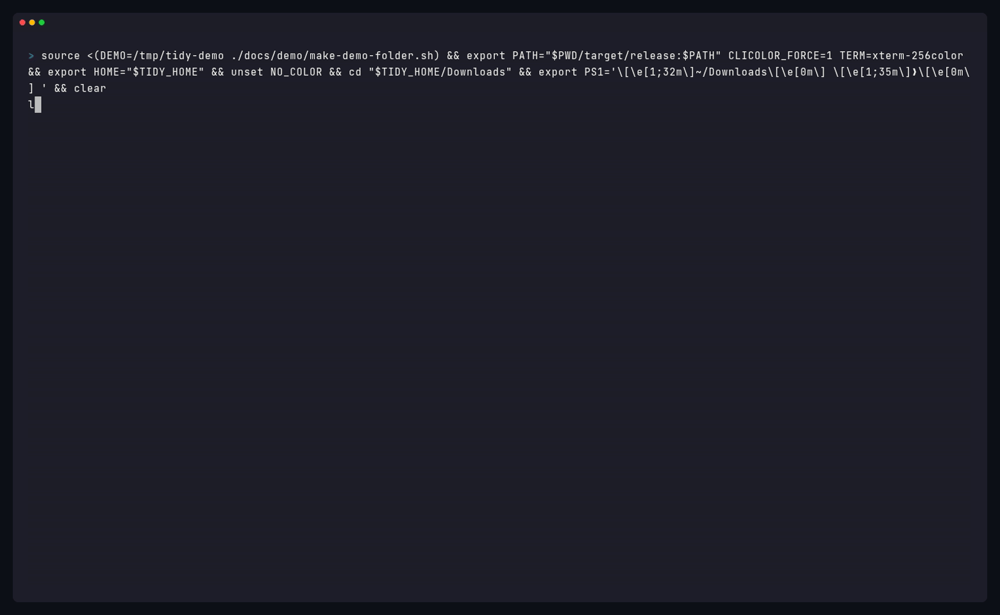

**tidy 0.4** leaves folders named like files alone, keeps the duplicate that has been in the folder longest, and adds an optional daily `tidy --apply` job.

### Highlights

- **Folders are folders.** Only `.pages`, `.numbers`, `.key`, and `.rtfd` are document packages (one item, moved or trashed whole). A directory named `Ubuntu.dmg` or `Vacation.png` is skipped, even if a rule lists that extension. Preview and `tidy explain` mark packages with a trailing `/` and a `(package)` label; a skipped file-named folder says `folder, not a file: left in place`.
- **Duplicate keeper uses Date Added.** The kept copy is the one that has been in the folder longest (Finder's Date Added on macOS, otherwise the later of created and modified), then shortest name, then alphabetical. A just-copied twin that preserved an old mtime is the extra copy and goes to the Trash.
- **`tidy schedule`.** Opt-in daily cleanup, off by default. `tidy schedule --install` writes a launchd agent (`com.github.jherin89.tidy.daily`) that runs `tidy --apply` once a day (`--at HH:MM`, default 10:00). `--rules` and `--older-than` are stored in the plist. Distinct from `tidy watch` (different label, plist, and log). Each run is a normal apply, so `tidy undo` works. Nothing is installed until you pass `--install`; plain `tidy` stays a dry run.

### Install

Homebrew (tap formula rendered by `scripts/bump-homebrew.sh`):

```bash
brew install jherin89/tap/tidy
```

Or a release archive from this page:

| Platform | Archive |
| --- | --- |
| macOS, Apple Silicon and Intel | `tidy-0.4.0-universal-apple-darwin.tar.gz` |
| Linux x86_64 (static musl) | `tidy-0.4.0-x86_64-unknown-linux-musl.tar.gz` |
| Linux aarch64 (static musl) | `tidy-0.4.0-aarch64-unknown-linux-musl.tar.gz` |

Each `.tar.gz` has a matching `.sha256` (`shasum -a 256` layout). The binary is not notarized. On a Mac, clear quarantine after unpacking:

```bash
xattr -d com.apple.quarantine tidy-0.4.0-universal-apple-darwin/tidy
```

Or build from source: `cargo install --git https://github.com/Jherin89/tidy --tag v0.4.0`

### Known limitations

- The binary is not notarized.
- On macOS, `tidy undo` still cannot pull files back out of the Trash. It names each file and its original location so you can use Finder's **Put Back**. Moved files come back on their own. The default Trash method is Finder so Put Back is offered. `TIDY_TRASH_METHOD=nsfilemanager` is the headless alternative and may not offer Put Back.
- `tidy schedule --install` / `tidy watch --install` and the real-Trash path were checked with a fake `launchctl` and with the macOS CI job. Run `scripts/mac-smoke-test.sh` on a real Mac to confirm the agents, Date Added, packages, folders named like files, and Finder Put Back together.
- The real-Trash test runs in CI with `TIDY_TRASH_METHOD=nsfilemanager`, so the default Finder method was not exercised there.
- `tidy schedule --install` is macOS-only (same as `tidy watch --install`). On Linux, run `tidy --apply` from a systemd timer or cron.
