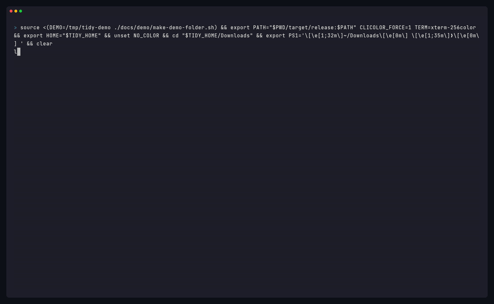

**tidy 0.5** files month folders by Date Added, shares one launchd installer for watch and the daily job, builds on macOS 15, and can notarize the Mac binary once Apple Developer secrets are configured. This archive is still unsigned.

### Highlights

- **Month folders follow Date Added.** `by_date = true` puts a file in `YYYY-MM` using the same age as `older_than` and the duplicate keeper: Finder's Date Added when it exists, otherwise the later of created and modified. A screenshot copied today lands in the current month even if its name or modified time is older. `tidy explain` prints that stamp next to the destination.
- **One launchd builder, two agents.** `tidy watch` and `tidy schedule` share a plist builder and installer. They stay separate jobs (`com.github.jherin89.tidy` with KeepAlive, and `com.github.jherin89.tidy.daily` running `tidy --apply` on a calendar). CI lints both plists with `plutil`.
- **CI and releases use macOS 15.** The universal binary is still lipo'd from Apple Silicon and Intel, and the Linux archives stay static musl.
- **Notarization is wired, and not turned on yet.** The release job signs and notarizes only when the Apple Developer secrets are set. They are not set for 0.5.0, so this archive is unsigned, same as 0.4.0. See the README section "Notarizing the Mac binary" for the exact secrets and the order to create them. A bare binary inside the tar.gz is not stapled.

### Install

Homebrew (tap formula rendered by `scripts/bump-homebrew.sh`):

```bash
brew install jherin89/tap/tidy
```

Or a release archive from this page:

| Platform | Archive |
| --- | --- |
| macOS, Apple Silicon and Intel | `tidy-0.5.0-universal-apple-darwin.tar.gz` |
| Linux x86_64 (static musl) | `tidy-0.5.0-x86_64-unknown-linux-musl.tar.gz` |
| Linux aarch64 (static musl) | `tidy-0.5.0-aarch64-unknown-linux-musl.tar.gz` |

Each `.tar.gz` has a matching `.sha256` (`shasum -a 256` layout). The 0.5.0 binary is not notarized. On a Mac, clear quarantine after unpacking a release archive:

```bash
xattr -d com.apple.quarantine tidy-0.5.0-universal-apple-darwin/tidy
```

Homebrew installs do not need that step. Once the Apple secrets are configured, a later release can be signed and notarized; Gatekeeper can check that ticket online. This archive is not that build.

Or build from source: `cargo install --git https://github.com/Jherin89/tidy --tag v0.5.0`

### Known limitations

- The 0.5.0 binary is not signed or notarized. The release workflow skips signing until `APPLE_CERTIFICATE_P12_BASE64`, `APPLE_CERTIFICATE_PASSWORD`, `APPLE_SIGNING_IDENTITY`, and a complete notary login (Apple ID trio or App Store Connect API key trio) are stored as GitHub Actions secrets. No secret values are in this repository.
- On macOS, `tidy undo` still cannot pull files back out of the Trash. It names each file and its original location so you can use Finder's **Put Back**. Moved files come back on their own. The default Trash method is Finder so Put Back is offered. `TIDY_TRASH_METHOD=nsfilemanager` is the headless alternative and may not offer Put Back.
- `tidy schedule --install` / `tidy watch --install` and the real-Trash path were checked with a fake `launchctl` and with the macOS CI job. Run `scripts/mac-smoke-test.sh` on a real Mac to confirm the agents, Date Added, month folders, packages, folders named like files, and Finder Put Back together.
- The real-Trash test runs in CI with `TIDY_TRASH_METHOD=nsfilemanager`, so the default Finder method was not exercised there.
- `tidy schedule --install` is macOS-only (same as `tidy watch --install`). On Linux, run `tidy --apply` from a systemd timer or cron.
- `xcrun stapler` cannot staple a Mach-O that ships inside a `.tar.gz`. After notarization is turned on, Gatekeeper looks the ticket up online.
