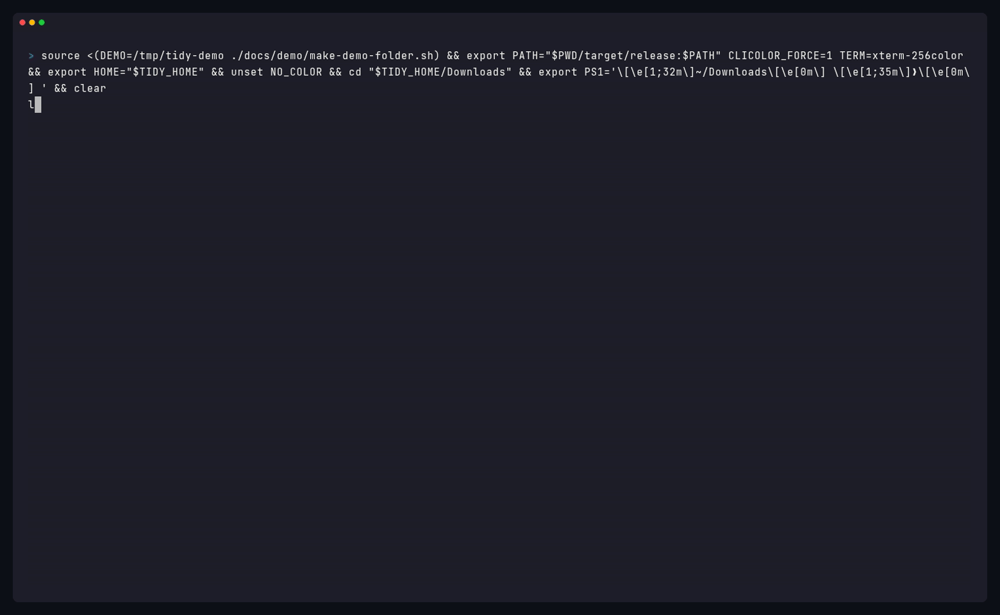

**tidy 0.6** can claim a file with `keep` so later rules leave it alone, and `tidy undo --dry-run` shows a reversal before anything moves. This archive is still unsigned.

### Highlights

- **`keep` rules.** `action = "keep"` matches like any other rule and then stops. The file stays where it is. A later duplicate or age rule does not move or trash it in that run. The preview, `tidy explain`, and JSON show `keep` / `kept` and the rule name. `--apply` writes no undo entry for it. `destination` and `by_date` on a keep rule are an error. `--older-than` on the command line still filters before rules. Other files can still be extra copies of a kept file.
- **Undo has a dry run.** `tidy undo --dry-run` reads the newest log that has not been undone and prints what undo would do: move back, restore from Trash, Finder Put Back, skip a missing file, or rename when the original name is taken. Nothing moves, and the log stays pending. `--json` prints `"mode": "dry-run"` with `would-move-back`, `would-restore`, `manual`, `missing`, or `failed`. Then `tidy undo` performs that same plan.
- **Notarization is still off.** The release job signs and notarizes only when the Apple Developer secrets are set. They are not set for 0.6.0, so this archive is unsigned, same as 0.5.0. See the README section "Notarizing the Mac binary". A bare binary inside the tar.gz is not stapled. `scripts/mac-smoke-test.sh` now includes an `undo --dry-run` check, and it has not been run on a real Mac for this release.

### Install

Homebrew (tap formula rendered by `scripts/bump-homebrew.sh`):

```bash
brew install jherin89/tap/tidy
```

Or a release archive from this page:

| Platform | Archive |
| --- | --- |
| macOS, Apple Silicon and Intel | `tidy-0.6.0-universal-apple-darwin.tar.gz` |
| Linux x86_64 (static musl) | `tidy-0.6.0-x86_64-unknown-linux-musl.tar.gz` |
| Linux aarch64 (static musl) | `tidy-0.6.0-aarch64-unknown-linux-musl.tar.gz` |

Each `.tar.gz` has a matching `.sha256` (`shasum -a 256` layout). The 0.6.0 binary is not notarized. On a Mac, clear quarantine after unpacking a release archive:

```bash
xattr -d com.apple.quarantine tidy-0.6.0-universal-apple-darwin/tidy
```

Homebrew installs do not need that step. Once the Apple secrets are configured, a later release can be signed and notarized; Gatekeeper can check that ticket online. This archive is not that build.

Or build from source: `cargo install --git https://github.com/Jherin89/tidy --tag v0.6.0`

### Known limitations

- The 0.6.0 binary is not signed or notarized. The release workflow skips signing until `APPLE_CERTIFICATE_P12_BASE64`, `APPLE_CERTIFICATE_PASSWORD`, `APPLE_SIGNING_IDENTITY`, and a complete notary login (Apple ID trio or App Store Connect API key trio) are stored as GitHub Actions secrets. No secret values are in this repository.
- On macOS, `tidy undo` still cannot pull files back out of the Trash. The dry run and the real undo both name each file and its original location so you can use Finder's **Put Back**. Moved files come back on their own. The default Trash method is Finder so Put Back is offered. `TIDY_TRASH_METHOD=nsfilemanager` is the headless alternative and may not offer Put Back.
- `tidy schedule --install` / `tidy watch --install` and the real-Trash path were checked with a fake `launchctl` and with the macOS CI job. Run `scripts/mac-smoke-test.sh` on a real Mac to confirm the agents, Date Added, month folders, packages, folders named like files, undo dry-run, and Finder Put Back together. That Mac smoke test is still pending for 0.6.0.
- The real-Trash test runs in CI with `TIDY_TRASH_METHOD=nsfilemanager`, so the default Finder method was not exercised there.
- `tidy schedule --install` is macOS-only (same as `tidy watch --install`). On Linux, run `tidy --apply` from a systemd timer or cron.
- `xcrun stapler` cannot staple a Mach-O that ships inside a `.tar.gz`. After notarization is turned on, Gatekeeper looks the ticket up online.
