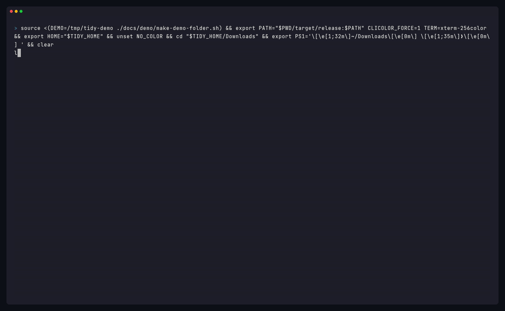

**tidy 1.0.0** is the final, feature-complete release. Behavior is the same as 0.6.0. The project is in maintenance-free, archived-style status: no further development is planned. This archive is still unsigned.

### What tidy does

Across 0.x, tidy became a dry-run-first organizer for a messy Downloads folder:

- A plain `tidy` prints the plan. `--apply` moves files and sends matches to the Trash. Nothing is permanently deleted.
- Rules in TOML match extension, glob, age, size, and extra byte-identical copies. The first match wins. Actions are `move` (optional `YYYY-MM` folders), `trash`, and `keep` (claim the file and stop later rules).
- Age is Finder's Date Added on macOS, otherwise the later of created and modified. That stamp also picks the duplicate keeper and `by_date` month folders.
- `.pages`, `.numbers`, `.key`, and `.rtfd` packages move as one item. Other folders are skipped, including a folder named like a file.
- `tidy explain` shows why one file matched. `tidy undo --dry-run` prints a reversal before anything moves. `tidy undo` puts moved files back. On macOS, Trash items are named for Finder **Put Back**.
- `tidy watch` files new downloads as they settle. `tidy watch --install` and `tidy schedule --install` are optional macOS launchd agents (a live watcher, and a daily `tidy --apply`). Both are off until you install them.

### Install

Homebrew (tap formula rendered by `scripts/bump-homebrew.sh`):

```bash
brew install jherin89/tap/tidy
```

The formula conflicts with Homebrew's `tidy-html5` (HTML Tidy), which installs the same command name.

Or a release archive from this page:

| Platform | Archive |
| --- | --- |
| macOS, Apple Silicon and Intel | `tidy-1.0.0-universal-apple-darwin.tar.gz` |
| Linux x86_64 (static musl) | `tidy-1.0.0-x86_64-unknown-linux-musl.tar.gz` |
| Linux aarch64 (static musl) | `tidy-1.0.0-aarch64-unknown-linux-musl.tar.gz` |

Each `.tar.gz` has a matching `.sha256` (`shasum -a 256` layout). The 1.0.0 binary is not notarized. On a Mac, clear quarantine after unpacking a release archive:

```bash
xattr -d com.apple.quarantine tidy-1.0.0-universal-apple-darwin/tidy
```

Homebrew installs do not need that step. Gatekeeper will not treat this GitHub archive as a notarized app. A bare binary inside the tar.gz is not stapled.

Or build from source: `cargo install --git https://github.com/Jherin89/tidy --tag v1.0.0`

### Known limitations

- The 1.0.0 binary is not signed or notarized. The release workflow skips signing until `APPLE_CERTIFICATE_P12_BASE64`, `APPLE_CERTIFICATE_PASSWORD`, `APPLE_SIGNING_IDENTITY`, and a complete notary login (Apple ID trio or App Store Connect API key trio) are stored as GitHub Actions secrets. Those secrets are not set. No secret values are in this repository. No notarized build is planned.
- On macOS, `tidy undo` cannot pull files back out of the Trash. The dry run and the real undo both name each file and its original location so you can use Finder's **Put Back**. Moved files come back on their own. The default Trash method is Finder so Put Back is offered. `TIDY_TRASH_METHOD=nsfilemanager` is the headless alternative and may not offer Put Back.
- `tidy schedule --install` / `tidy watch --install` and the real-Trash path were checked with a fake `launchctl` and with the macOS CI job. `scripts/mac-smoke-test.sh` has not been run on a real Mac for this release.
- The real-Trash test runs in CI with `TIDY_TRASH_METHOD=nsfilemanager`, so the default Finder method was not exercised there.
- `tidy schedule --install` is macOS-only (same as `tidy watch --install`). On Linux, run `tidy --apply` from a systemd timer or cron.
- `xcrun stapler` cannot staple a Mach-O that ships inside a `.tar.gz`.
